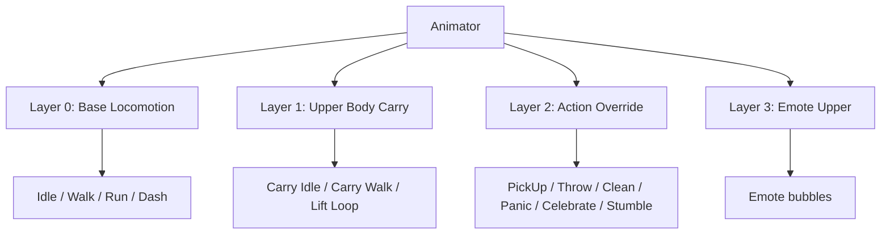
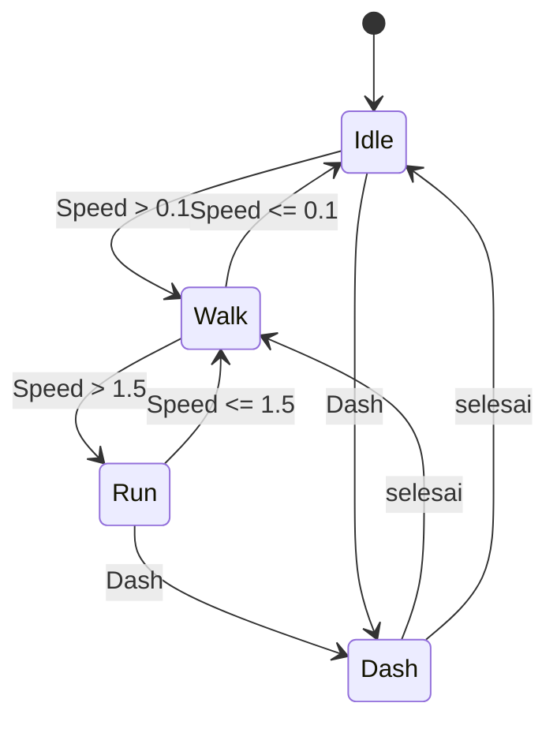

# ANIMATION DOCUMENTATION — No, Please Clean the Room!
## Gimersia 2026 · Gaya "Exaggerated Cartoon"

> Dokumen produksi animasi. Rujukan: `Art Direction.md`, `GDD.md`, `PackagesDocumentation.md`.
> Semua clip 30 FPS, in-place, Humanoid Mecanim, dengan aksen squash/stretch via DOTween.

---

## 0. Ringkasan Keputusan

| Keputusan | Nilai |
| :--- | :--- |
| Gaya | Kartun lebay: anticipation besar, overshoot, squash & stretch, hold |
| Rig | Humanoid Mecanim, ≤ 30 bone, T-pose |
| Produksi | Keyframe manual di Blender + aksen DOTween di Unity |
| Timing | Smooth 30 FPS + spacing ekstrem (bukan stepped) |
| Clip inti | 12 clip Tier A; tambahan Tier B/C didokumentasikan |
| Carry | Upper/lower body split via Avatar Mask |
| Root motion | Off (in-place); rotasi & gerak diatur gameplay |
| Emosi | Sprite emoticon bubble, tanpa blendshape |

**Prinsip tiap keputusan:** animasi harus terbaca dari kamera 3/4 top-down, di split-screen setengah resolusi, dan tidak boleh mengorbankan respons input.

---

## 1. Prinsip Animasi "Lebay"

Gunakan 12 prinsip animasi, tapi dengan angka yang dibesar-besarkan:

1. **Anticipation** — selalu ada, 6–10 frame, arah berlawanan dengan aksi.
2. **Squash & Stretch** — maksimal 1,25× / 0,80×; jangan sampai rusak volume.
3. **Overshoot** — 10–15% melewati target sebelum settle.
4. **Follow-through** — kepala, tangan, dan benda yang dibawa telat 2–3 frame.
5. **Arcs** — gerakan tangan melengkung 1,5–2× lebih lebar dari realistis.
6. **Staging** — pose ekstrem harus menghadap kamera, bukan menyembunyikan aksi.
7. **Exaggeration** — kalau ragu, lebihkan 20%, lalu potong saat terasa terlalu.
8. **Timing** — aksi cepat (2–4 frame), recovery lambat (6–12 frame).
9. **Holds** — tahan pose ekstrem 4–8 frame agar terbaca.
10. **Appeal** — pose harus lucu dari silhouette saja.
11. **Weight** — berat terasa dari percepatan, bukan dari lambatnya gerak.
12. **Secondary action** — antena rambut, celemek, atau barang ikut bergoyang.

**Aturan emas:** jika ragu, **potong durasi aksi dan tambah hold**. Animasi kartun terasa lebay karena *spacing*, bukan karena banyak frame.

**Larangan**
- Tidak ada gerakan linear pada tubuh organik (kecuali impact/snap).
- Tidak ada idle yang benar-benar diam; minimal napas 2–3 frame.
- Tidak ada animasi realistik hasil mocap tanpa di-rekey.
- Tidak ada gerakan yang membuat karakter menutupi objek gameplay penting.

---

## 2. Spesifikasi Rig

**Struktur**
- Humanoid, T-pose, skala 1 unit = 1 m, tinggi ±1,05 m.
- Maksimal **30 bone**, tanpa bone jari (tangan mitten), thumb opsional.
- Root bone di origin (0,0,0), menghadap +Z di Unity.

**Daftar bone minimum**

```text
Root
└── Hips
    ├── Spine
    │   └── Chest
    │       ├── Neck
    │       │   └── Head
    │       ├── Shoulder.L → UpperArm.L → LowerArm.L → Hand.L
    │       └── Shoulder.R → UpperArm.R → LowerArm.R → Hand.R
    ├── UpperLeg.L → LowerLeg.L → Foot.L → Toes.L
    └── UpperLeg.R → LowerLeg.R → Foot.R → Toes.R
```

**Sockets (empty transform, bukan bone)**
- `HandSocket_L`, `HandSocket_R` — barang ringan.
- `CarryPivot` — di chest, untuk barang sedang/berat.
- `LiftSocket_L`, `LiftSocket_R` — kerja sama angkat berdua.
- `EmoteAnchor` — di atas kepala untuk balon emosi.

**Aturan rig**
- Weight painting bersih; tidak ada vertex yang ikut bone salah.
- Tidak ada twist bone tambahan untuk jam; gunakan roll yang benar.
- Test deformasi ekstrem (angkat, lempar, nungging, lompat) sebelum export.
- Kedua karakter memakai skeleton dan Avatar yang **identik** agar clip bisa dipakai bersama.

---

## 3. Animator Layer dan Avatar Mask



| Layer | Mask | Weight | Blend | Isi |
| :--- | :--- | :--- | :--- | :--- |
| Base Locomotion | Full body | 1 | — | Idle, Walk, Run, Dash |
| Upper Body Carry | Upper body | 0 → 1 | Override | Carry Idle, Carry Walk, Lift Loop |
| Action Override | Full body | 0 → 1 | Override | PickUp, Throw, Clean, Panic, Celebrate |
| Emote | Upper body | 0 → 1 | Override/Additive | Emote (Tier C) |

**Mask definition**
- `Mask_Upper`: Spine, Chest, Neck, Head, Shoulder.L/R, UpperArm.L/R, LowerArm.L/R, Hand.L/R.
- `Mask_Lower`: Hips, UpperLeg.L/R, LowerLeg.L/R, Foot.L/R, Toes.L/R.
- `Mask_Full`: semua.

**Aturan**
- Layer Action di atas Carry agar lempar/pickup menimpa pose bawa.
- Layer Emote di atas semua (kecuali Action) dan otomatis turun setelah 1,2 s.
- Jangan memakai Additive untuk pose tubuh penuh; hasilnya sulit diprediksi.

---

## 4. Parameter Animator dan State Machine

**Parameter**

| Nama | Tipe | Dipakai oleh | Catatan |
| :--- | :--- | :--- | :--- |
| `Speed` | Float | Base | 0 = idle, 1 = walk, 2 = run |
| `IsCarrying` | Bool | Carry layer | Menyalakan upper body carry |
| `IsHeavyCarry` | Bool | Carry layer | Pose bawa berat (dua tangan) |
| `LiftActive` | Bool | Carry layer | Mode angkat berdua |
| `Action` | Trigger | Action layer | PickUp / Throw / Clean / Stumble |
| `IsPanicking` | Bool | Action layer | Loop panik saat waktu kritis |
| `Celebrate` | Trigger | Action layer | Sekali di akhir level |
| `Dash` | Trigger | Base | Dash sekali |
| `Emote` | Trigger | Emote layer | Peluk / Tos / Semangat / Iseng |
| `MoodState` | Int | Opsional | 0 Semangat, 1 Nyaman, 2 Kesal, 3 Bete (face/idle additive) |

**State machine Base**



**Aturan transisi**
- Lokomosi: 0,12 s, interruptible.
- Masuk aksi: 0,05 s; keluar aksi: 0,10 s.
- Carry on/off: 0,15 s.
- Panic: 0,20 s.
- Action tidak boleh memotong Action lain kecuali diizinkan (Throw > Panic ya, PickUp > Throw tidak).
- **Tidak ada exit time** untuk aksi yang dipicu input; gunakan trigger + interrupt.

---

## 5. Daftar Clip

Semua frame pada 30 FPS. Kolom "Authoring Speed" dipakai untuk sinkronisasi langkah (lihat §9).

### 5.1 Tier A — 12 clip inti (wajib, Hari 1–5)

| # | Clip | Frame | Loop | Layer | Authoring Speed | Catatan |
| :--- | :--- | :--- | :--- | :--- | :--- | :--- |
| 1 | `ANIM_Idle_Base` | 90 | Ya | Base | — | Napas + weight shift + kepala kecil |
| 2 | `ANIM_Walk_Base` | 24 | Ya | Base | 1,6 m/s | Contact–Down–Pass–Up; langkah chunky |
| 3 | `ANIM_Run_Base` | 20 | Ya | Base | 3,5 m/s | Condong depan 10–15°, tangan besar |
| 4 | `ANIM_Dash_Base` | 18 | Tidak | Base | 7,0 m/s | Anticipation 4f, burst 2f, skid 6f, settle 6f |
| 5 | `ANIM_PickUp_Base` | 24 | Tidak | Action | — | Reach 6f, grab 2f, lift 10f, settle 6f |
| 6 | `ANIM_Throw_Base` | 30 | Tidak | Action | — | Wind-up 8f, release 3f, follow 10f, settle 9f |
| 7 | `ANIM_CarryIdle_Upper` | 72 | Ya | Carry | — | Barang ringan di depan dada; goyang halus |
| 8 | `ANIM_CarryWalk_Upper` | 24 | Ya | Carry | 1,4 m/s | Sinkron dengan Walk base |
| 9 | `ANIM_LiftLoop_Upper` | 40 | Ya | Carry | — | Dua tangan menahan beban; effort loop |
| 10 | `ANIM_Clean_Mop` | 48 | Ya | Action | — | Sapuan 120°, 6f sapu, 2f hold, 4f balik |
| 11 | `ANIM_Panic_Loop` | 36 | Ya | Action | — | Tangan flail, kepala geleng, kaki cepat |
| 12 | `ANIM_Celebrate` | 45 | Tidak | Action | — | Anticipation jongkok 6f, lompat 8f, mendarat 6f |

### 5.2 Tier B — menambah konten (Hari 5–7, jika waktu cukup)

| # | Clip | Frame | Loop | Layer | Catatan |
| :--- | :--- | :--- | :--- | :--- | :--- |
| 13 | `ANIM_CarryRun_Upper` | 20 | Ya | Carry | Sinkron dengan Run; barang bergoyang |
| 14 | `ANIM_LiftStart_Upper` | 24 | Tidak | Carry | Jongkok + tarik napas |
| 15 | `ANIM_LiftEnd_Upper` | 20 | Tidak | Carry | Lepas + stretch lega |
| 16 | `ANIM_Exhausted_Loop` | 60 | Ya | Action | Tangan di lutut, napas berat |
| 17 | `ANIM_Stumble` | 30 | Tidak | Action | Terpeleset lucu, bukan jatuh menyakitkan |
| 18 | `ANIM_DoorPush` | 28 | Tidak | Action | Dorong pintu dengan bahu |
| 19 | `ANIM_Land` | 12 | Tidak | Base | Squash 4f + recover 8f |
| 20 | `ANIM_PickUp_Heavy` | 30 | Tidak | Action | Dua tangan, effort lebih besar |

### 5.3 Tier C — emotes (pasca-jam / jika ada waktu)

| # | Clip | Frame | Loop | Catatan |
| :--- | :--- | :--- | :--- | :--- |
| 21 | `ANIM_Emote_Happy` | 36 | Ya | Balon emosi senang |
| 22 | `ANIM_Emote_Angry` | 36 | Ya | Balon emosi kesal |
| 23 | `ANIM_Emote_Tired` | 36 | Ya | Balon emosi lelah |
| 24 | `ANIM_Emote_Confused` | 36 | Ya | Balon emosi bingung |
| 25 | `ANIM_Emote_Taunt` | 36 | Ya | Balon emosi jahil |
| 26 | `ANIM_Emote_Cheer` | 36 | Ya | Balon emosi sorak |

### 5.4 Clip Mood — kondisional (jika fitur Mood masuk MVP)

Fitur Mood (§15 GDD) membutuhkan emote berpasangan. Jika Mood masuk vertical slice, dua clip pertama naik ke **Tier A** (total 14 clip inti); sisanya Tier B.

| # | Clip | Frame | Loop | Layer | Catatan |
| :--- | :--- | :--- | :--- | :--- | :--- |
| 27 | `ANIM_Emote_Hug` | 45 | Tidak | Emote | Berpasangan; kedua karakter sinkron; 1,5 s; hati VFX |
| 28 | `ANIM_Emote_HighFive` | 21 | Tidak | Emote | 0,7 s; sparkle di titik kontak |
| 29 | `ANIM_Emote_Cheer` | 24 | Tidak | Emote | 0,8 s; satu tangan ke atas |
| 30 | `ANIM_Emote_Tease` | 24 | Tidak | Emote | 0,8 s; gerakan jahil, tidak menurunkan mood |

**Aturan emote berpasangan**
- Peluk mengunci **kedua** pemain 1,5 s; animasi harus lucu, singkat, dan tidak menutupi objek gameplay.
- Kedua karakter memakai clip yang sama dan diposisikan berhadapan oleh gameplay.
- Jika pasangan di luar jangkauan, clip tidak diputar; muncul bubble "?".
- Emote tidak boleh memotong aksi kritis (lempar/membersihkan) yang sedang berjalan; antrekan atau batalkan dengan feedback.
- Cooldown animasi mengikuti `MoodConfig`, bukan hardcoded di Animator.

---

## 6. Timing dan Spacing

**Pola umum satu aksi**

| Fase | Frame | Aturan |
| :--- | :--- | :--- |
| Anticipation | 6–10 | Arah berlawanan; makin besar aksi, makin dalam |
| Action | 2–4 | Sangat cepat; boleh 1 frame di tengah |
| Overshoot | 2–3 | 10–15% melewati pose akhir |
| Settle | 6–12 | Kembali ke pose netral dengan ease out |
| Hold | 4–8 | Tahan pose ekstrem bila perlu keterbacaan |

**Nilai spacing ekstrem**
- Langkah lari: kontak 1 frame, pass 3 frame, up 2 frame.
- Lempar: wind-up 8 frame hampir tanpa gerak, lalu release dalam 3 frame.
- Mop: sapuan cepat 6 frame, hold 2, balik 4.
- Pickup: tangan mencapai objek dalam 6 frame, tahan 2, angkat 10.

**Kurva interpolasi**
- Default: Bezier ease-in/out.
- Impact/landing: konstan/linear 1–2 frame lalu ease out.
- Jangan memakai `Linear` pada gerakan organik.

---

## 7. Squash, Stretch, dan Aksen DOTween

Animasi di Blender memberi pose dasar. "Lebay" tambahan datang dari tween di Unity.

| Momen | Efek | Nilai | Durasi |
| :--- | :--- | :--- | :--- |
| Ambil barang | Punch scale | 1,08 → 1,0, vibrato 5 | 0,2 s |
| Lempar (release) | Stretch + rotasi | scale Y 1,12 / XZ 0,92 | 0,15 s |
| Mendarat | Squash | Y 0,82 / XZ 1,22 | 0,12 s lalu 0,2 s recover |
| Barang snap ke drop-zone | Punch + sparkle | 1,15 → 1,0 | 0,25 s |
| Timer kritis | Warna + denyut | merah berkedip | loop |
| Emote bubble | Pop | scale 0 → 1,15 → 1,0 | 0,3 s |
| Panik | Camera shake | 0,08 amplitude | 0,2 s |

Contoh implementasi:

```csharp
using DG.Tweening;
using UnityEngine;

public class CartoonJuice : MonoBehaviour
{
    [SerializeField] private Transform _visualRoot;

    public void PlayLandSquash()
    {
        _visualRoot.DOKill();
        _visualRoot.localScale = new Vector3(1.22f, 0.82f, 1.22f);
        _visualRoot.DOScale(Vector3.one, 0.2f)
                   .SetEase(Ease.OutBack)
                   .SetLink(gameObject);
    }

    public void PlayThrowStretch()
    {
        _visualRoot.DOKill();
        _visualRoot.localScale = new Vector3(0.92f, 1.12f, 0.92f);
        _visualRoot.DOScale(Vector3.one, 0.15f)
                   .SetEase(Ease.OutQuad)
                   .SetLink(gameObject);
    }
}
```

**Aturan**
- Squash/stretch hanya pada `visualRoot`, **bukan** root yang punya collider/rigidbody.
- Selalu `.SetLink(gameObject)` atau `.Kill()` saat objek bisa hilang.
- Jangan menumpuk dua tween pada properti yang sama.
- Aksen tidak boleh mengubah posisi gameplay (hanya visual).

---

## 8. Upper/Lower Body Split (Carry)

**Cara kerja**
- Base layer memutar Walk/Run untuk kaki.
- Carry layer (mask upper) menimpa lengan/dada/leher/kepala dengan pose membawa.
- Barang ringan: parent ke `CarryPivot`; barang berat: dua tangan via `LiftSocket`.
- Berat barang mengubah pose: ringan satu tangan, sedang dua tangan, berat dua tangan + condong belakang.

**Aturan**
- Kecepatan gerak berkurang saat membawa (diatur gameplay, bukan animasi).
- Animasi kaki tetap Walk/Run; jangan membuat clip carry berjalan penuh (kecuali Tier B `CarryRun_Upper` untuk fine-tuning).
- Saat membawa berat, condong 8–12° ke belakang + tangan getar halus 2 frame.
- Transisi `IsCarrying` tidak boleh menghentikan gerak kaki.

---

## 9. Root Motion dan Sinkronisasi Langkah

- **In-place**: semua clip tanpa root motion; Animator `Apply Root Motion` off.
- Gameplay memutar karakter menghadap arah gerak (Slerp, ±15 rad/s) dan memindahkan transform.
- Tidak perlu 8 arah clip; rotasi model sudah cukup untuk kamera top-down.
- Sinkronisasi langkah: `Animator.speed = actualSpeed / authoringSpeed`.
  - Walk: authoring 1,6 m/s.
  - Run: authoring 3,5 m/s.
  - Dash: authoring 7,0 m/s.
- Toleransi foot slide: **≤ 5%** panjang langkah pada kecepatan default.
- Jika gameplay mengubah kecepatan, koordinasi dengan Abdi/Raffa agar `authoringSpeed` diperbarui, bukan animasi dipelintir.

**Aturan rotasi**
- Rotasi hanya untuk visual model; collider tetap.
- Saat mengepel/melempar, karakter boleh "mengunci" arah hadap sesuai aksi.

---

## 10. Two-Player Lift (Kerja Sama)

**Alur**
1. P1 mendekat → `LiftStart_Upper` (jika ada) atau langsung `LiftLoop_Upper`.
2. P2 mendekat → `LiftActive` true; kedua karakter masuk `LiftLoop_Upper`.
3. Gameplay mengikat barang ke dua `LiftSocket` dan menyamakan kecepatan.
4. Lepas → `LiftEnd_Upper` + stretch lega.

**Aturan animasi**
- Kedua karakter harus memakai clip yang sama agar sinkron.
- Barang tidak boleh mengambang; socket mengikuti tangan.
- Saat `LiftActive`, Walk/Run berjalan lebih lambat dan condong ke belakang.
- Jika salah satu pemain lepas, barang jatuh dengan dust puff.

---

## 11. Socket dan Attachment Barang

| Barang | Socket | Catatan |
| :--- | :--- | :--- |
| Ringan (buku, piring) | `HandSocket_R` | Satu tangan |
| Sedang (kardus, ember) | `CarryPivot` | Dua tangan di depan dada |
| Berat (sofa, kulkas) | `LiftSocket_L/R` | Dua pemain |
| Alat (sapu, pel) | `HandSocket_R` | Grip di tengah handle |

**Aturan**
- Tidak memakai IK tangan; animasi harus sudah menempatkan tangan di posisi socket.
- Offset socket diuji di Blender dan Unity; simpan sebagai prefab socket.
- Barang yang dipegang tidak boleh menembus badan/karakter (cek dengan pose ekstrem).

---

## 12. Animation Events (SFX & VFX)

| Clip | Frame | Event | Aksi |
| :--- | :--- | :--- | :--- |
| Walk | 40%, 90% | `Footstep_L`, `Footstep_R` | SFX langkah |
| Run | 35%, 85% | `Footstep_L`, `Footstep_R` | SFX langkah cepat |
| Dash | 6 | `DashWhoosh` | SFX + dust |
| PickUp | 12 | `GrabContact` | Attach + dust puff |
| Throw | 16 | `ThrowWhoosh` | SFX |
| Throw | 18 | `Release` | Detach + impulse + stretch |
| Clean_Mop | 8, 32 | `MopSplash` | SFX + bubble VFX |
| Celebrate | 8 | `JumpWhoosh` | SFX |
| Celebrate | 22 | `Land` | Squash + SFX |
| Stumble | 6 | `Slip` | SFX komik |
| Emote_Hug | 10 | `EmoteHug` | SFX + VFX hati |
| Emote_HighFive | 8 | `EmoteClap` | SFX + sparkle |
| Emote_Cheer | 6 | `EmoteCheer` | SFX |
| Emote_Tease | 6 | `EmoteTease` | SFX |

**Aturan**
- Event tidak boleh memicu logika gameplay yang bisa menggandakan state; hanya SFX/VFX/attach.
- Timing event diuji ulang setelah retiming clip.

---

## 13. Emosi dan Emote

- Tanpa blendshape. Ekspresi memakai **sprite balon emosi** di `EmoteAnchor`.
- Balon: 128×128, gaya flat 2-tone, pop via DOTween, tampil 1,2 s.
- Ekspresi wajah opsional: 3 tekstur (normal, senang, panik) via material swap (Tier B).
- Emote tidak boleh menutupi HUD atau objek interaktif di depan kamera.

---

## 14. Perbedaan Rasa P1 dan P2

| Aspek | P1 Suami | P2 Istri |
| :--- | :--- | :--- |
| Amplitude | ×1,15 (berat, mantap) | ×1,25 (ringan, bouncy) |
| Cadence | ×0,9 (lebih lambat) | ×1,1 (lebih cepat) |
| Head bob | Kecil | Lebih besar |
| Carry | Condong belakang, effort | Lebih tegak, lincah |
| Mop | Sapuan lebar, tenaga besar | Sapuan cepat, ritmis |

Implementasi termurah: `Animator.speed` multiplier + duplikasi clip dengan timing diubah (Tier B). Jangan membuat dua set penuh untuk Tier A.

---

## 15. Import Settings Unity

**Rig**
- Animation Type: Humanoid.
- Avatar Definition: Create From This Model (karakter pertama), Copy From Other Avatar (karakter kedua).
- Optimize: on.

**Animation clip**
- Loop Time: sesuai tabel.
- Loop Pose: on untuk clip loop.
- Root Transform Rotation: Bake Into Pose **off**.
- Root Transform Position (Y): Bake Into Pose **off**.
- Root Transform Position (XZ): Bake Into Pose **off**.
- Compression: Optimal; Rotation Error 0,5; Position Error 0,5; Scale Error 1,0.
- Keyframe Reduction: on.
- Events: sesuai §12.

**Animator**
- Apply Root Motion: off.
- Culling Mode: Always Animate (karakter selalu terlihat).
- Update Mode: Normal.

---

## 16. Naming dan Folder

- Clip: `ANIM_<Aksi>_<Varian>` → `ANIM_Walk_Base`, `ANIM_CarryIdle_Upper`, `ANIM_LiftLoop_Upper`.
- Controller: `AC_Player_P1`, `AC_Player_P2`.
- Mask: `Mask_Upper`, `Mask_Lower`, `Mask_Full`.
- Folder: `Assets/Art/Animations/{Clips,Controllers,Masks,Avatars}`.
- Jangan mengubah `.meta`; jangan menaruh clip di luar folder ini.

---

## 17. QA Checklist Animasi

- [ ] Loop mulus (frame pertama = frame terakhir untuk clip loop).
- [ ] Tidak ada foot sliding > 5% pada kecepatan default.
- [ ] Siluet pose ekstrem terbaca dari kamera 3/4 dan split-screen.
- [ ] Squash/stretch tidak merusak volume dan tidak mengubah collider.
- [ ] Transisi antar state tidak pop (0,05–0,15 s).
- [ ] Carry upper/lower tidak saling menimpa aneh.
- [ ] Socket barang pas; tidak menembus tubuh.
- [ ] Animation events tepat setelah retiming.
- [ ] Tidak ada clip yang membuat karakter menutupi objek gameplay.
- [ ] 30 FPS, nama file benar, loop time benar.
- [ ] Diuji di build, bukan hanya Editor.

---

## 18. Jadwal Sprint 7 Hari (Animasi)

| Hari | Target | PIC |
| :--- | :--- | :--- |
| 1 | Rig kedua karakter + Idle/Walk/Run | Haidar |
| 2 | PickUp, Throw, Carry Idle/Walk + layer carry | Haidar, Raffa |
| 3 | Clean_Mop, Panic + events | Haidar, Fito |
| 4 | Lift Loop + integrasi angkat berdua | Haidar, Abdi |
| 5 | Karakter kedua, flavor P1/P2, Tier B awal | Haidar |
| 6 | Aksen DOTween, emote, polish timing | Fito, Haidar |
| 7 | QA animasi, build test, bug fix | Semua |

---

## 19. Kontrak Integrasi untuk Programmer

Usulan API (letakkan di `Assets/Resources/Scripts/Interface&Schema/`):

```csharp
public interface IPlayerAnimationDriver
{
    void SetLocomotion(float speed01);
    void SetCarrying(bool isCarrying, bool isHeavy);
    void SetLiftActive(bool active);
    void PlayAction(PlayerAction action);
    void SetPanic(bool active);
    void PlayEmote(EmoteType emote);
}
```

- `PlayerAction`: `PickUp`, `Throw`, `Clean`, `Stumble`, `Celebrate`.
- Semua parameter Animator hanya diubah lewat driver ini, bukan langsung dari banyak script.
- Jangan memanggil `Animator.Play` langsung kecuali untuk debug.

---

## 20. Asumsi

1. Kedua karakter berbagi skeleton/Avatar identik.
2. Tidak ada mocap; semua keyframe manual.
3. Tanpa IK tangan/kaki; akurasi dari animasi + socket.
4. Emote memakai sprite, bukan blendshape.
5. `authoringSpeed` adalah nilai awal; tuning final bersama gameplay.

---

*Dokumen ini hidup. Perubahan gaya timing atau struktur clip harus lewat ADR.*
