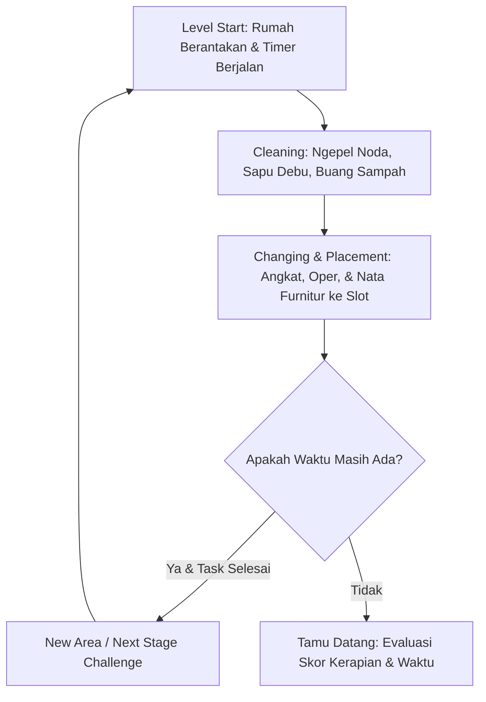
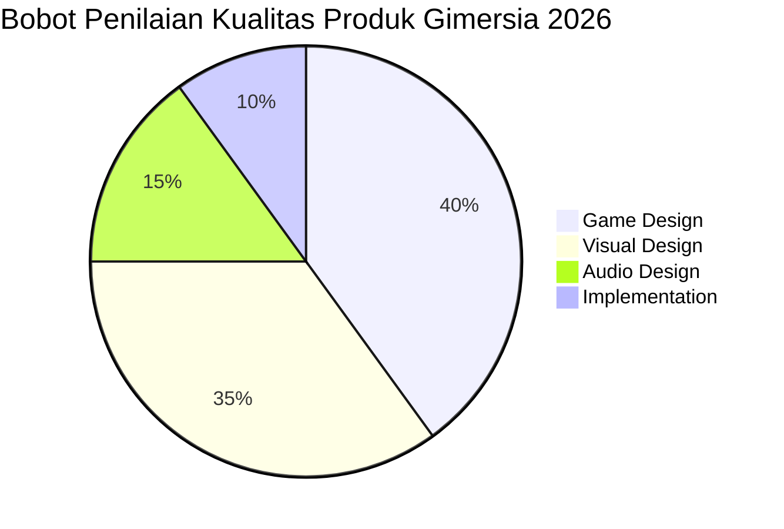

# GAME DESIGN DOCUMENT (GDD)
# No, Please Clean the Room! (Chaos Room)
**A Co-op Time-Attack House Cleaning & Organizing Party Game**  
*Kompetisi Game Jam / Gimersia 2026 (#GIMERSIA2026)*

---

## 1. Informasi Umum & Identitas Game

| Parameter | Detail |
| :--- | :--- |
| **Judul Game (Working Titles)** | **No, Please Clean the Room!** *(Alternatif: Chaos Room / Crash, Clean, Chaos)* |
| **Tema Game Jam** | **Gotong Royong** **Pulang** **Melestarikan** *(Gimersia 2026 - AGI & Kemenparekraf)* |
| **Genre** | Asymmetric Co-op, Time-Attack, Simulation / Party Game |
| **Platform** | PC (Windows / Unity URP) |
| **Target Audience** | Pemain game kasual & party game (Pico Park, Overcooked, Moving Out lovers, It Take two) |
| **Skala Produk (Target)** | **Vertical Slice** (1 Tutorial Dojo/Martial Arts + 3 Stages Utama) |
| **Target Waktu Pengembangan** | Sprint 7 Hari |
| **Prinsip Aset** | **100% Human Made — Strictly NO AI (ò_ó)** |

---

## 2. Visi & Pengalaman Bermain (Game Vision & Experience)

### 2.1. What Experience? (Rasa yang Diincar)
> **"Fun, Jahil, Chaos, dan Dikejar-kejar Waktu"**
Game menghadirkan suasana kepanikan yang menyenangkan *(hilarious chaos)* ketika dua pemain harus berkejaran dengan batas waktu yang ketat untuk menuntaskan pekerjaan rumah tangga yang berantakan sebelum tamu kehormatan/keluarga tiba.

### 2.2. Where is the Fun? (Sumber Kesenangan)
* **Gotong Royong & Kerja Sama:** Tugas tidak bisa diselesaikan sendirian secara efisien. Pemain harus berbagi ruang, mengoper barang, dan saling melengkapi kelebihan/kelemahan karakter.
* **Fisika Objek & Jahil:** Lempar-lemparan barang antar pemain, tabrakan, dan kekacauan perabotan saat panik.
* **Kepuasan Membersihkan (Tidy Up Satisfaction):** Transisi ruangan dari berantakan total dan kotor menjadi kinclong dan rapi sebelum timer berbunyi.
* **Chemistry Pasangan (Mood & Emote):** Mood tiap karakter memengaruhi performa; peluk/tos ke pasangan memulihkan mood dan membuat kerja sama terasa hidup.

### 2.3. Minimum Viable Product (MVP)
* Core loop berjalan solid (Cleaning & Tidy Up).
* Sensasi **Fun** tercapai melalui interaksi fisika & batas waktu.
* **Game Feel & Juice** maksimal (efek visual debu, kilap lantai, screen shake ringan, pop feedback penataan).

---

## 3. Cerita & Latar Belakang (Story & Narrative)

### 3.1. Premis Cerita
Sepasang suami istri yang baru pulang ke rumah lama mereka untuk merayakan hari raya Lebaran (**Level 1**). Namun saat sampai, kondisi rumah berantakan tak terkira, sementara tamu dan keluarga besar akan segera datang berkunjung.

Dengan panik namun bersemangat, keduanya bekerja sama membersihkan rumah secepat kilat. Setelah berhasil menyelesaikannya tepat waktu, mereka menyadari bahwa kombinasi kemampuan mereka berdua sangat luar biasa:
* Sang Suami memiliki tenaga fisik monster.
* Sang Istri memiliki kecepatan dan ketelitian bersih-bersih tingkat dewa.

Dari pengalaman tersebut, mereka memutuskan untuk mendirikan jasa pembersih profesional bertajuk:
> **"Home Succoring: Chaos but Clean"**

### 3.2. Progresi Naratif
Mereka merekam aksi bersih-bersih mereka yang heboh ke media sosial/internet. Video mereka viral, pelanggan berdatangan, dan dari uang hasil pekerjaan tersebut, mereka mulai merenovasi serta mengisi kamar-kamar kosong di rumah impian mereka.

---

## 4. Desain Karakter Asimetris (Asymmetric Character Design)

Game menggunakan sistem kerja sama asimetris di mana kedua karakter memiliki spesialisasi dan batasan fisik yang berbeda secara signifikan:

```
┌─────────────────────────────────┐      ┌─────────────────────────────────┐
│        P1: SUAMI                │      │        P2: ISTRI                │
│    (Spesialis Tenaga / Brawn)   │      │ (Spesialis Sanitasi & Agility)  │
├─────────────────────────────────┤      ├─────────────────────────────────┤
│ • Angkat/pindah furnitur CEPAT  │      │ • Bersih-bersih & ngepel CEPAT  │
│ • Bisa angkat barang berat solo │      │ • Kecepatan lari gesit          │
│ • Lemparan barang SANGAT JAUH   │      │ • Memindahkan barang lambat     │
│ • Bersih-bersih noda LAMBAT     │      │ • Barang berat tidak bisa solo  │
│ • Lari lambat - stamina stabil  │      │ • Lemparan barang DEKAT         │
│                                 │      │ • Stamina lari cepat habis      │
└─────────────────────────────────┘      └─────────────────────────────────┘
```

### Rincian Atribut:
1. **Player 1 - Suami (Spesialis Tenaga):**
   * **Strength:** Mampu memindahkan meja, sofa, dan kulkas sendirian dengan kecepatan normal.
   * **Throwing Power:** Dapat melempar kardus/barang melintasi ruangan atau koridor.
   * **Cleaning Efficiency:** Lambat saat mengepel lantai atau membersihkan debu.
   * **Mobility:** Kecepatan lari moderat, namun konsumsi stamina sangat stabil dan tidak mudah terengah-engah.

2. **Player 2 - Istri (Spesialis Kebersihan):**
   * **Cleaning Mastery:** Sekali sapu/pel, noda kotoran langsung hilang dalam hitungan detik.
   * **Agility:** Memiliki base move speed dan burst dash yang sangat kencang.
   * **Strength Limitation:** Sangat lambat saat menggeser furnitur sedang; tidak mampu mengangkat perabotan berat sendirian (harus dibantu P1 atau ditarik bersama).
   * **Throwing Power:** Jarak lempar barang pendek (toss pendek).
   * **Stamina:** Bar stamina cepat terpakai bila berlari terus-menerus.

---

## 5. Core Gameplay Loop & Mekanik Utama

### 5.1. Visualisasi Core Loop



### 5.2. Detail Mekanik (Mechanic Breakdown)
1. **Movement & Stamina System:**
   * 8-arah pergerakan isometrik/top-down.
   * Tombol *Sprint/Dash* untuk bergerak cepat dengan biaya stamina.
2. **Grab, Carry & Drop:**
   * Menyorot objek terdekat dengan highlight outline dinamis.
   * Mengangkat objek ringan (buku, sampah, piring, kardus) atau menggeser objek berat.
3. **Throw & Pass (Lempar / Oper):**
   * Memungkinkan oper-operan barang melompati sekat atau rintangan.
   * Jika barang dilempar sembarangan ke lantai keras, dapat menambah tingkat kekacauan (*chaos feedback*).
4. **Cleaning (Sanitasi Ruangan):**
   * Alat pembersih (Sapu, Pel, Kemoceng) yang diletakkan di sudut ruangan.
   * Pemain berinteraksi dengan genangan air/noda kotoran hingga persentase noda mencapai 0%.
5. **Drop-Zone & Snapping (Penataan):**
   * Area transparan/marker lantai yang menandai posisi ideal suatu furnitur/barang.
   * Ketika barang diletakkan di posisi yang benar, akan muncul feedback audio-visual *snap & sparkle*.
6. **Weight & Two-Player Lift:**
   * Objek memiliki kategori bobot: *Light* (1 pemain bebas), *Medium* (P2 lambat, P1 normal), *Heavy* (P2 tidak bisa angkat sendiri, butuh bantuan P1 untuk angkat cepat).
7. **Mood & Chemistry (Pasangan):**
   * Setiap karakter punya mood 0–100 yang memengaruhi kecepatan bersih-bersih, radius bersih, kecepatan bawa, jarak lempar, dan regen stamina.
   * Mood turun karena waktu dan kesalahan; naik lewat emote ke pasangan (Peluk, Tos, Semangat, Iseng).
   * Detail aturan, angka, HUD, dan dampak skor ada di §15.

---

## 6. Desain Level & Progresi (Level Design Structure)

Berdasarkan rancangan tata letak (*floorplan*) pada FigJam:

```
┌────────────────────────────────────────────────────────────────────────┐
│ [Level 0: Tutorial] ──► [Level 1: Lebaran] ──► [Level 2] ──► [Level 3] │
│   Dojo Martial Arts       Ruang Mandiri          Relokasi       Grand  │
│   Linear 5 Chambers       (Dapur/TV/Gudang)    Antar Ruangan    Chaos  │
└────────────────────────────────────────────────────────────────────────┘
```

### 6.1. Level 0: Tutorial — "Martial Arts Dojo"
Level pelatihan bergaya dojo latihan bela diri yang melatih mekanik dasar secara bertahap dalam 5 ruangan terhubung secara linear (*Drag-Drop Mission*):
* **Ruangan 0:** Pengenalan kontrol pergerakan, dash, dan kamera.
* **Ruangan 1:** Latihan mengangkat, membawa, dan meletakkan barang pada drop-zone (*Grab & Drop*).
* **Ruangan 2:** Latihan membersihkan noda kotoran dan genangan (*Cleaning Tool*).
* **Ruangan 3:** Latihan melempar barang melintasi celah/jurang pendek ke rekan setim (*Passing/Throw*).
* **Ruangan 4:** Latihan koordinasi mengangkat benda berat bersama-sama.

### 6.2. Level 1: "Mudik Lebaran" (Internal Room Clean)
* **Tata Letak:** 3 Ruangan utama (Dapur, Ruang TV, Gudang) + Area Halaman/Taman (Garden).
* **Desain Misi:** Membersihkan dan menata kembali barang-barang di dalam ruangan yang bersangkutan.
  * Tugas Dapur: Cuci/bereskan perabot masak & pel tumpahan sirup.
  * Ruang TV: Rapikan sofa, bantal, kabel, dan bersihkan debu karpet.
  * Gudang: Masukkan kardus-kardus parsel yang tercecer.
* **Fokus Pelajaran:** Adaptasi pembagian peran antara P1 (angkat beban) dan P2 (pembersih cepat).

### 6.3. Level 2: "Relokasi Antar Ruang" (Cross-Room Logistics)
* **Tata Letak:** 4 Ruangan bersebelahan dengan koridor sempit dan pintu penghubung + Garden.
* **Desain Misi:** Barang-barang dari keempat ruangan harus disortir dan dipindahkan ke 1 ruangan pusat (misalnya seluruh tumpukan barang rongsok dipindah ke gudang).
* **Tantangan:** Rute koridor sempit yang sering terjadi *traffic jam* jika kedua pemain tidak berkomunikasi, serta pintu geser/ayun yang mengharuskan kerja sama menahan pintu.

### 6.4. Level 3: "Grand Chaos" (The Ultimate Combine)
* **Tata Letak:** Rumah besar lantai luas gabungan banyak ruangan (Ruang Tamu, Ruang Keluarga, Dapur, Koridor, dan Halaman Luar).
* **Desain Misi:** Kombinasi seluruh mekanik secara simultan: membuang sampah ke halaman luar, memindahkan lemari pakaian, mengepel jejak kaki kotor, dan menata meja makan sebelum bel rumah berbunyi.

---

## 7. Arsitektur Ruangan (Room Classification)

Referensi tipe ruangan yang telah disiapkan untuk variasi misi:

| Kategori | Daftar Ruangan |
| :--- | :--- |
| **Ruang Inti (Core Rooms)** | Ruang Tamu, Ruang Keluarga, Ruang Makan, Kamar Tidur Utama, Kamar Tidur Anak, Kamar Tidur Tamu, Dapur, Kamar Mandi, Toilet. |
| **Ruang Tambahan (Expansions)** | Ruang Kerja, Ruang Belajar, Ruang Bermain Anak, Ruang Ibadah / Musala, Ruang TV, Ruang Baca / Perpustakaan, Ruang Musik, Ruang Olahraga, Ruang Laundry / Cuci, Ruang Setrika, Gudang, Ruang Penyimpanan, Ruang Keluarga Kecil, Ruang Hobi. |
| **Area Servis & Sirkulasi** | Foyer / Ruang Masuk, Koridor, Area Tangga, Ruang Bawah Tangga, Ruang Panel Listrik, Ruang Mesin / Pompa Air, Walk-in Closet, Pantry. |

---

## 8. Arahan Visual & Aset (Visual & Art Direction)

### 8.1. Gaya Visual & Referensi
* **Style:** 3D Stylized / Low-Poly Cozy Isometric.
* **Game Referensi:** *Moving Out 2*, *Overcooked! All You Can Eat*, *Unpacking*, *House Flipper*.
* **Suasana:** Cerah, ceria, hangat, penuh warna, dan jenaka.

### 8.2. Palet Warna Resmi ("THE ROMANTIC")
Hex Codes palet warna yang diacu dari FigJam:
* 🌸 **Rose Salmon:** `#F2AAAA`
* 🌺 **Coral Blush:** `#E38382`
* 🩵 **Pastel Cyan / Aqua:** `#A8D8DF`
* 🌌 **Deep Plum / Navy Dark:** `#251F44`

### 8.3. Efek Visual & Shaders
* **Free Outline Shader:** Menyorot objek yang dapat diinteraksi (*interactable items*) menggunakan package `Linework Lite` yang telah diintegrasikan.
* **VFX Partikel:**
  * Puff asap debu kartun saat mengangkat perabot kotor.
  * Efek busa dan kilau (*sparkle*) saat lantai bersih.
  * Emoticon bubble melayang di atas kepala karakter (panik, lelah, gembira).

---

## 9. Arahan Audio (Audio & Juice Direction)

* **BGM (Music):** Musik santai akustik/lo-fi jazzy pada detik-detik awal yang bertransisi menjadi instrumen tempo cepat dan dinamis ketika timer tersisa 30 detik (memicu kepanikan seru).
* **SFX Interaksi:**
  * Bunyi langkah kaki gesit & gesekan kaki saat dash.
  * Suara benturan tumpul furnitur kayu saat diletakkan/dilempar.
  * Suara squish/slosh alat pel dan genangan air.
  * Notifikasi jingle keberhasilan (*snap-in-place success chimes*).
  * Efek suara bel pintu rumah (*ding-dong!*) saat waktu habis menandakan tamu tiba.

---

## 10. Matriks Penilaian Gimersia 2026 (EKRAF & AGI Rubric)

Pemetaan strategi desain agar memperoleh nilai maksimal pada proses kurasi:



### 10.1. Game Design (40% Bobot Total)
* **Unique Concept (15%):** Diferensiasi unik melalui mekanik co-op asimetris Suami vs Istri dalam tema bersih-bersih rumah tangga khas budaya lokal (persiapan Lebaran/gotong royong).
* **Fun Experience (10%):** Kebebasan melempar barang, adegan panik bersama teman, fisika ragdoll/benda.
* **Intuitive Control (5%):** Hanya membutuhkan tombol arah, lari, interaksi ambil/lempar, dan tombol pel.
* **Clear Progression (5%):** Progresi tantangan jelas dari 1 ruangan sederhana hingga relokasi 4 ruangan terpadu.
* **Effective FTUE Tutorial (5%):** Level 0 "Martial Arts" mengenalkan 1 aksi per ruangan secara langsung tanpa teks tutorial panjang.

### 10.2. Visual Design (35% Bobot Total)
* **Coherent Visual (15%):** Konsistensi warna palet *The Romantic* pada lingkungan dan karakter.
* **Polished Visual Assets (10%):** Model 3D perabot rumah yang rapi, pencahayaan URP yang hangat.
* **Effective Visual Feedback (5%):** Outline shader penanda objek interaktif dan meter bar kebersihan.
* **Intuitive User Interface (5%):** Tampilan HUD minim gangguan: Timer jam dinding di sudut atas, progress bar rumah bersih di bagian tengah.

### 10.3. Audio Design (15% Bobot Total)
* **Engaging Audio (10%):** Musik latar bertempo adaptif yang memompa adrenalin.
* **Effective Feedback (5%):** Tiap aksi (geser, lempar, pel) memiliki audio cue yang renyah dan langsung dipahami telinga pemain.

### 10.4. Implementation (10% Bobot Total)
* Frame rate stabil di 60 FPS, arsitektur Unity URP yang optimal, tanpa crash.

---

## 11. Struktur Tim & Pembagian Tugas (Team Roster)

Berdasarkan kesepakatan pembagian peran pada FigJam board:

| Nama Anggota | Posisi / Peran Utama | Tanggung Jawab Spesifik |
| :--- | :--- | :--- |
| **Abdi** | Lead Game Design, Programmer Feel & System | Arsitektur mekanik utama, tuning kontrol & feel pergerakan karakter, perancangan aturan permainan. |
| **Fito** | Game Design, Programmer Juice & VFX Artist | Efek partikel visual (debu, sparkle, busa), screen feel, juice feedback, polishing gameplay. |
| **Raffa** | Gameplay Programmer | Karakter controller (P1 & P2), kontrol kamera isometrik dinamis, sistem interaksi objek. |
| **Rasyid** | UI Programmer & Shader Programmer | Integrasi UI/HUD, sistem timer, implementasi shader outline (`Linework Lite`) dan highlight material. |
| **Faris** | 3D Environment & Texturing Artist | Modeling lingkungan rumah, furnitur, layout ruangan, dan texturing konsisten. |
| **Haidar** | 3D Character Artist & Animator | Modeling karakter Suami & Istri, rigging, dan animasi aksi (jalan, lari, angkat, lempar, ngepel). |
| **Irfan** | UI/UX Designer & Sound Designer | Desain antarmuka HUD/Menu, komposisi BGM, perancangan SFX interaksi dan voice feedback. |
| **Nikkow** | UI/UX Designer & 2D UI Artist | Pembuatan icon, typography, ilustrasi visual menu, layout panduan, dan branding aset game. |

---

## 12. Rencana Kerja Sprint 7 Hari (Timeline Milestone)

```
Hari 1: Setup Proyek, Integrasi Input & Kontrol Karakter Dasar (P1 & P2)
Hari 2: Implementasi Mekanik Grab, Carry, Throw, dan Sistem Berat Benda
Hari 3: Implementasi Mekanik Cleaning (Pel/Sapu) & Drop-Zone Penataan
Hari 4: Level Blockout (Level 0 Dojo Tutorial + Level 1 Rumah Lebaran)
Hari 5: Desain Level 2 & 3, Pemasangan Aset 3D Final & Texturing
Hari 6: Integrasi Audio (BGM/SFX), Shader Outline, UI/HUD, dan VFX Juice
Hari 7: Playtesting, Bug Fixing, Balancing Waktu, Build Standalone & Video Gameplay
```

---
*Dokumen ini disusun sebagai panduan resmi pengembangan gim "No, Please Clean the Room!" pada repositori Gimersia 2026.*


## 13. Win & Lose Condition
Win : Tidy up room correctly
Lose : No Lose Condition (Cuma perbedaan score bintang diakhir)

## 14. Progression & Currency
Progression dari game kami adalah unlock map baru, ruangan baru, tantangan baru, rintangan baru. (level based)

setiap kelarin level dia cuma nampilin score, time left, bintang, dan gold coin

bintang -> Anchimenet, tiap level punya aturan khusu biar dapet bintang

coin -> didapatkan dari collecting coin yang spawn dan dari hasil score dan bintang, coin digunakan untuk dekorasi rumah character, membuka area ruangan baru dan bebas menempatkan furniture apa disana

---

## 15. Mood & Chemistry (Sistem Mood Pasangan)

### 15.1 Tujuan Desain
* Memberi dimensi emosional pada kerja sama suami–istri: bukan dua karakter terpisah, tapi satu tim yang saling menjaga suasana.
* Menghukum kerja sama yang buruk (melempar sembarangan, bertabrakan, meninggalkan pasangan) dan memberi reward pada interaksi sosial.
* **Tidak boleh** menciptakan *dead time*, mengunci aksi, atau membuat pemain merasa dihukum tanpa bisa bereaksi.

### 15.2 Empat Mood

| Mood | Rentang | Perilaku | Visual |
| :--- | :--- | :--- | :--- |
| **Semangat** | 80–100 | Bekerja paling cepat dan efisien | Wajah senang, langkah bouncy, sparkle kecil sesekali |
| **Nyaman** | 50–79 | Performa normal (baseline) | Netral, default |
| **Kesal** | 20–49 | Melambat, mudah terengah | Wajah cemberut, idle menghela napas, bubble uap kecil |
| **Bete / Mogok** | 0–19 | Paling lambat, tetapi tetap bisa menyelesaikan misi | Badan membungkuk, langkah berat, sweat drop, garis komik |

Mood awal setiap level: **60 (Nyaman)**. Mood tidak disimpan antar-level.

### 15.3 Efek Gameplay (Pengali)

| Aksi | Semangat | Nyaman | Kesal | Bete |
| :--- | :--- | :--- | :--- | :--- |
| Kecepatan bersih-bersih | ×1,20 | ×1,00 | ×0,80 | ×0,65 |
| Radius / area bersih | ×1,15 | ×1,00 | ×0,85 | ×0,75 |
| Kecepatan membawa barang | ×1,10 | ×1,00 | ×0,90 | ×0,80 |
| Jarak lempar | ×1,10 | ×1,00 | ×0,85 | ×0,75 |
| Regen stamina | ×1,20 | ×1,00 | ×0,80 | ×0,65 |
| Durasi angkat barang berat | ×0,90 | ×1,00 | ×1,15 | ×1,30 |

**Aturan keras:** tidak ada pengali 0. Semua aksi tetap bisa dilakukan di mood terendah — hanya lebih lambat. Efek mood **tidak** menimpa perbedaan asimetris P1/P2; keduanya dikalikan di atas stat dasar masing-masing.

### 15.4 Perubahan Mood

| Sumber | Delta | Cooldown | Catatan |
| :--- | :--- | :--- | :--- |
| Waktu berjalan | −1 / 8 detik | — | Dimatikan di Level 0 (tutorial) |
| Melempar barang sembarangan / jatuh | −4 | 3 detik | Hanya saat barang sampai di lantai keras |
| Bertabrakan dengan pasangan | −2 | 5 detik | Komedi, bukan hukuman besar |
| Menyelesaikan task ruangan | +4 | — | Per task |
| Barang masuk drop-zone dengan benar | +6 | — | Per barang |
| Oper barang ke pasangan berhasil | +2 | 2 detik | |
| Bersih-bersih dalam radius 3 m dari pasangan | +1 / 4 detik | — | Mendorong kerja bareng |
| Peluk pasangan | +25 | 25 detik | +35 jika mood pasangan < 20 |
| Tos pasangan | +12 | 12 detik | |
| Semangat ke pasangan | +8 | 10 detik | |
| Iseng ke pasangan | +6 | 10 detik | Tidak pernah menurunkan mood |

Mood dibatasi **5–100**. Tidak ada mood 0 permanen.

### 15.5 Emote Pasangan

| Emote | Jangkauan | Durasi kunci | Efek | Cooldown |
| :--- | :--- | :--- | :--- | :--- |
| **Peluk** | 2,0 m | 1,5 detik (kedua pemain) | +25 mood target (+35 jika < 20) | 25 detik |
| **Tos** | 2,0 m | 0,7 detik | +12 mood target | 12 detik |
| **Semangat** | 3,0 m | 0,8 detik | +8 mood target | 10 detik |
| **Iseng** | 2,5 m | 0,8 detik | +6 mood target | 10 detik |

* Emote selalu gratis, tanpa biaya stamina.
* Jika pasangan di luar jangkauan, muncul bubble "?" — tidak ada mood yang berubah.
* Peluk mengunci **kedua** pemain sebentar; animasi harus lucu dan singkat agar tidak terasa menyiksa saat timer kritis.
* Cooldown global antar-emote: 1 detik.
* Emote dipilih lewat *radial wheel* 4 pilihan.

### 15.6 Aturan Anti-Frustrasi
* Level 0 (tutorial): decay waktu **dimatikan**.
* Tidak ada *lose condition* karena mood (konsisten dengan §13).
* Mood tidak pernah menurunkan kecepatan gerak dasar karakter; hanya efisiensi kerja.
* Opsi aksesibilitas: **"Mood Decay Off"** di menu pengaturan.
* Saat mood < 20, muncul prompt halus: "Peluk pasanganmu" (bukan pop-up yang menghentikan game).
* Split-screen: prompt dan meter mood tampil di viewport masing-masing.

### 15.7 Feedback Visual & Audio
* Wajah karakter berganti sesuai mood (3 state tekstur: normal, senang, kesal; Tier B).
* Idle posture berubah: Semangat lebih tegak, Bete membungkuk (additive pose, Tier B).
* Peluk memunculkan VFX hati; Tos memunculkan sparkle; Bete memunculkan sweat drop.
* BGM menambah layer instrumen saat rata-rata mood tinggi, dan meredup saat rendah.
* SFX khusus untuk tiap emote (peluk, tos, semangat, iseng).

### 15.8 HUD Mood
* Meter mood kecil di bawah portrait/nama pemain.
* Warna meter: Semangat `#F2C14E`, Nyaman `#A8D8DF`, Kesal `#B9A38A`, Bete `#251F44` dengan ikon wajah.
* Ikon wajah 4 state (Nikkow).
* Emote wheel radial dengan 4 ikon + indikator cooldown.
* Rata-rata mood tim ditampilkan di layar hasil.

### 15.9 Dampak ke Skor, Bintang, dan Koin
Contoh formula awal (tuning di `MoodConfig`):

```text
Score = (Cleanliness% × 60) + (TimeLeft% × 25) + (AverageMood% × 15)
```

| Bintang | Syarat |
| :--- | :--- |
| ★★★ | Cleanliness 100%, sisa waktu ≥ 30%, rata-rata mood ≥ 70 |
| ★★ | Cleanliness ≥ 85%, sisa waktu ≥ 10%, rata-rata mood ≥ 50 |
| ★ | Level selesai |

* Koin: `50 + (25 × bintang) + round(averageMood / 100 × 30)`.
* **Chemistry Bonus:** jika kedua pemain ≥ 80 saat level selesai, tambah +10 koin dan efek perayaan khusus.
* Mood menyumbang maksimal 15% skor, sehingga tidak mendominasi pemain yang main cepat.

### 15.10 Implementasi Teknis (Usulan)
* `MoodConfig` — ScriptableObject: threshold, decay, gain, pengali, cooldown, opsi aksesibilitas.
* `MoodSystem` — per pemain: `CurrentMood`, `MoodState`, `GetMultiplier(MoodAction)`, event `OnMoodChanged` / `OnMoodStateChanged`.
* `PartnerEmoteController` — validasi jangkauan & cooldown, memicu animasi berpasangan, menerapkan mood.
* `MoodAction` — enum: `CleanSpeed`, `CleanRadius`, `CarrySpeed`, `ThrowRange`, `StaminaRegen`, `HeavyLiftTime`.
* Gameplay (gerak, bawa, lempar, bersih) **membaca pengali** dari `MoodSystem`, bukan menyimpan logika mood sendiri.
* Mood bersifat *per-run* dan tidak disimpan; hanya preferensi aksesibilitas yang disimpan (JSON).
* Semua angka berasal dari `MoodConfig`; tidak ada angka mood yang di-hardcode.

### 15.11 Dampak ke Tim
| Anggota | Tanggung Jawab Mood |
| :--- | :--- |
| **Abdi** | Desain sistem, `MoodConfig`, tuning angka, aturan skor |
| **Raffa** | Integrasi pengali ke gerak, bawa, lempar, bersih |
| **Fito** | VFX hati, sparkle, sweat drop, juice feedback |
| **Rasyid** | HUD meter mood, emote wheel, layar hasil |
| **Irfan** | SFX emote + layer BGM adaptif |
| **Nikkow** | 4 ikon mood + 4 ikon emote |
| **Haidar** | Animasi Peluk, Tos, Semangat, Iseng (berpasangan) |

### 15.12 Catatan Keseimbangan
* Uji pertama: apakah pemain pernah mencapai Semangat tanpa dipaksa? Jika tidak, gain terlalu kecil.
* Uji kedua: apakah Bete membuat pemain berhenti main? Jika ya, pengali terlalu keras.
* Target: rata-rata mood tim sepanjang level **55–75** untuk pemain yang bekerja sama secara wajar.
* Jangan menambah mekanik mood lain (mis. rasa lapar, kantuk) sebelum sistem ini stabil.
